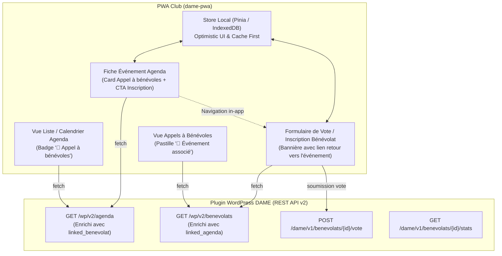

# Spécification Technique & Guide d'Intégration PWA — Liaison Agenda ⟷ Bénévolat

Ce document fournit l'ensemble des spécifications d'architecture, contrats d'API REST, interfaces TypeScript et directives d'expérience utilisateur (UX) pour supporter la **liaison bidirectionnelle entre Événements d'Agenda et Appels à Bénévoles** dans l'application mobile / PWA du club (`dame-pwa`).

---

## 1. Architecture & Principes Directeurs



### Principes Clés :
1. **Zéro requête superflue (Over-fetching / N+1)** : L'endpoint `/wp/v2/agenda` inclut directement l'objet condensé `linked_benevolat` (`id`, `title`, `slug`, `url`, `is_active`). La PWA sait instantanément si un appel est actif sans requêter l'API bénévolats.
2. **Navigation In-App Fluide** : Lorsqu'un adhérent consulte un événement d'agenda disposant d'un appel à bénévoles, le clic sur *« Participer comme bénévole »* route en interne vers `/benevolats/:id` (ou ouvre la modale de vote/créneaux), sans recharger la page web externe.
3. **Contrat PWA Strict** : Les interfaces TypeScript sont définies dans `src/types/api/agenda.ts` et `src/types/api/benevolat.ts` sans aucune adhérence au DOM ou aux fonctions globales WordPress.

---

## 2. Contrats de Données & Interfaces TypeScript

Ces types sont exposés par le package DAME via le point d'entrée `@dame/types` ou importables directement depuis `src/types/index.ts`.

### 2.1 Résumé de l'Appel à Bénévoles Lié (`LinkedBenevolatSummary`)

```typescript
export interface LinkedBenevolatSummary {
	/** ID numérique du post benevolat */
	id: number;
	/** Titre public de l'appel */
	title: string;
	/** Slug de l'appel pour le routage */
	slug: string;
	/** URL publique de repli */
	url: string;
	/** Indique si l'appel est publié et actif */
	is_active: boolean;
}
```

### 2.2 Résumé de l'Événement d'Agenda Lié (`LinkedAgendaSummary`)

```typescript
export interface LinkedAgendaSummary {
	/** ID numérique du post dame_agenda */
	id: number;
	/** Titre de l'événement */
	title: string;
	/** Date de début ISO (YYYY-MM-DD) */
	start_date: string;
	/** Date de fin ISO (YYYY-MM-DD) */
	end_date: string;
	/** Nom du lieu de l'événement si renseigné */
	location?: string;
	/** URL publique de l'événement */
	url: string;
}
```

### 2.3 Événement Agenda Enrichi (`AgendaEvent`)

```typescript
export interface AgendaEvent {
	id: number;
	modified?: string;
	title: {
		rendered: string;
		raw?: string;
	};
	content?: {
		rendered: string;
		raw?: string;
	};
	_dame_agenda_description_html?: string;
	categories_data?: AgendaEventCategory[];
	dame_agenda_category?: number[];

	/** Objet bénévole associé, ou null si aucun appel lié */
	linked_benevolat?: LinkedBenevolatSummary | null;

	meta: {
		_dame_start_date: string;
		_dame_end_date: string;
		_dame_start_time?: string;
		_dame_end_time?: string;
		_dame_all_day?: number | boolean;
		_dame_location_name?: string;
		_dame_city?: string;
		_dame_linked_benevolat_id?: number | null;
		_dame_linked_ha_campaign_id?: number | null;
		[key: string]: unknown;
	};
}
```

### 2.4 Bénévolat Enrichi (`Benevolat`)

```typescript
export interface Benevolat {
	id: number;
	modified: string;
	title: {
		rendered: string;
		raw?: string;
	};
	content?: {
		rendered: string;
	};
	dame_benevolat_data: BenevolatDay[];
	dame_benevolat_counts?: Record<string, number>;

	/** Événement agenda associé, ou null si aucun */
	linked_agenda?: LinkedAgendaSummary | null;

	meta?: {
		_dame_linked_agenda_id?: number | null;
	};
}
```

---

## 3. Spécifications des Endpoints REST

### 3.1 Endpoint Agenda : `GET /wp/v2/agenda`

#### Exemple de Requête :
```http
GET /wp-json/wp/v2/agenda?per_page=10&orderby=meta_value&after_date=2026-11-01 HTTP/1.1
Host: club.local
Authorization: Bearer <jwt_token>
Accept: application/json
```

#### Exemple de Réponse (Tronquée) :
```json
[
  {
    "id": 412,
    "date": "2026-11-05T10:00:00",
    "slug": "tournoi-d-automne-2026",
    "status": "publish",
    "title": {
      "rendered": "Tournoi d'Automne 2026"
    },
    "_dame_agenda_description_html": "<p>Grand tournoi d'échecs ouvert à tous les jeunes et adultes...</p>",
    "linked_benevolat": {
      "id": 850,
      "title": "Bénévoles — Installation & Buvette Tournoi d'Automne",
      "slug": "benevoles-installation-buvette-tournoi-automne",
      "url": "https://club.local/benevolat/benevoles-installation-buvette-tournoi-automne/",
      "is_active": true
    },
    "meta": {
      "_dame_start_date": "2026-11-15",
      "_dame_end_date": "2026-11-15",
      "_dame_start_time": "09:00",
      "_dame_end_time": "18:00",
      "_dame_location_name": "Salle Municipale des Fêtes",
      "_dame_city": "Nantes",
      "_dame_linked_benevolat_id": 850,
      "_dame_linked_ha_campaign_id": 42
    }
  }
]
```

---

### 3.2 Endpoint Bénévolats : `GET /wp/v2/benevolats`

#### Exemple de Requête :
```http
GET /wp-json/wp/v2/benevolats?per_page=5 HTTP/1.1
Host: club.local
Authorization: Bearer <jwt_token>
Accept: application/json
```

#### Exemple de Réponse (Tronquée) :
```json
[
  {
    "id": 850,
    "title": {
      "rendered": "Bénévoles — Installation & Buvette Tournoi d'Automne"
    },
    "linked_agenda": {
      "id": 412,
      "title": "Tournoi d'Automne 2026",
      "start_date": "2026-11-15",
      "end_date": "2026-11-15",
      "location": "Salle Municipale des Fêtes",
      "url": "https://club.local/agenda/tournoi-d-automne-2026/"
    },
    "dame_benevolat_data": [
      {
        "date": "2026-11-15",
        "time_slots": [
          { "start": "08:00", "end": "10:00", "needed": 4 },
          { "start": "12:00", "end": "14:00", "needed": 2 },
          { "start": "17:30", "end": "19:30", "needed": 4 }
        ]
      }
    ],
    "meta": {
      "_dame_linked_agenda_id": 412
    }
  }
]
```

---

## 4. Directives d'Implémentation UX pour la PWA

### 4.1 Vue Liste des Événements (`AgendaListView.vue`)
- Si `event.linked_benevolat?.is_active === true` :
  - Afficher un badge d'invitation avec icône :
    ```html
    <span class="badge badge-benevolat" @click.stop="openBenevolat(event.linked_benevolat.id)">
      🤝 Bénévoles demandés
    </span>
    ```
  - Couleur recommandée : Bleu institutionnel (`#2271b1` / `--ion-color-primary`), fond doux `#eef5fc`.

### 4.2 Fiche Détail de l'Événement (`AgendaDetailView.vue`)
- Placer l'encart **« Appel à bénévoles »** juste après les détails logistiques (Date, Horaires, Lieu) :
  - **Titre** : `🤝 Appel à bénévoles`
  - **Description** : *« Un appel à bénévoles est en cours pour cet événement : {{ event.linked_benevolat.title }}. Votre club a besoin de vous ! »*
  - **Bouton d'action principal (CTA)** :
    ```html
    <button class="btn btn-primary" @click="router.push(`/benevolats/${event.linked_benevolat.id}`)">
      🤝 Participer comme bénévole &rarr;
    </button>
    ```

### 4.3 Fiche de l'Appel à Bénévoles (`BenevolatView.vue`)
- Si `benevolat.linked_agenda` est présent :
  - Afficher une bannière en tête de formulaire :
    ```html
    <div class="banner-linked-agenda" @click="router.push(`/agenda/${benevolat.linked_agenda.id}`)">
      📅 Cet appel concerne l'événement : <strong>{{ benevolat.linked_agenda.title }}</strong> (le {{ formatDate(benevolat.linked_agenda.start_date) }})
    </div>
    ```

---

## 5. Stratégie Hors-Ligne & Cache Local (IndexedDB)

1. **Cache First avec Revalidation Réseau (Stale While Revalidate)** :
   - Les listes d'événements et d'appels à bénévoles sont stockées localement dans IndexedDB.
   - Les relations `linked_benevolat` et `linked_agenda` sont embarquées nativement dans les enregistrements mis en cache, garantissant leur affichage immédiat même en mode hors-ligne.
2. **Gestion Optimiste des Votes de Bénévolat** :
   - Lors de la soumission d'une participation (`POST /dame/v1/benevolats/:id/vote`), l'UI enregistre immédiatement le choix dans le store Pinia et incrémente le compteur local, puis synchronise en arrière-plan avec WordPress.

